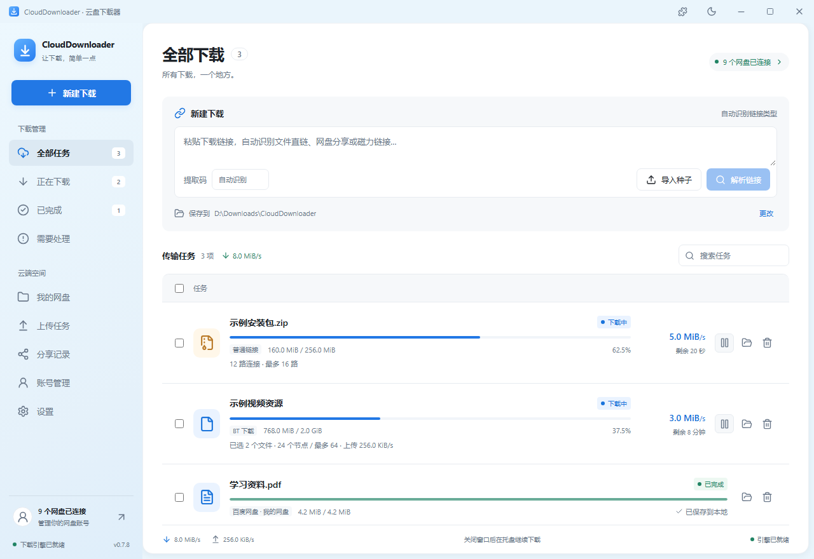
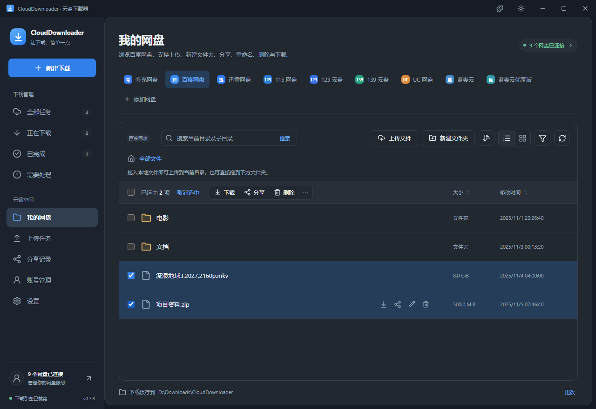

<p align="center">
  
</p>

<h1 align="center">CloudDownloader</h1>

<p align="center">
  <strong>文件直链 · 九个网盘 · BT 磁力与种子</strong><br />
  一个下载入口，自动识别链接，让文件抵达本地。
</p>

<p align="center">
  <a href="https://github.com/clover-us/CloudDownloader/releases/latest"></a>
  
  
</p>

<p align="center">
  <a href="#下载"><strong>下载应用</strong></a> ·
  <a href="#界面预览">界面预览</a> ·
  <a href="#支持的网盘">支持的网盘</a> ·
  <a href="docs/usage.md">使用指南</a> ·
  <a href="docs/development.md">开发文档</a>
</p>

---

## 下载

最新版本 **0.7.8**：设置页「开源仓库」链接与按钮改为指向本项目仓库 clover-us/CloudDownloader，点击直达项目主页；README 界面预览图更新至当前版本。浏览器接力确认窗、九个网盘与 BT 下载等能力保持不变。

| Windows 安装版 · 推荐                 | 便携版                                 |
| :------------------------------------ | :------------------------------------- |
| 自动创建快捷方式，适合日常使用。      | 解压即可运行，保留完整目录结构。       |
| **[↓ 下载 v0.7.8 安装包][installer]** | **[↓ 下载 v0.7.8 便携 ZIP][portable]** |

[全部版本与更新说明][releases] · [SHA-256 校验文件][checksums]

需要 **Windows 10 / 11 x64** 和 **Microsoft Edge WebView2 Runtime**。安装版会在缺少 WebView2 时引导下载运行时；便携版请运行目录中的 `CloudDownloader.exe`。

## 界面预览

**蓝白日间 · 统一入口与多来源任务**



<details>
<summary><strong>展开查看 Night 主题与个人网盘</strong></summary>

<br />



</details>

<sub>预览图使用演示账号与示例文件，仅展示界面和交互布局。</sub>

## 功能一览

| 功能                    | 可以做什么                                                       |
| :---------------------- | :--------------------------------------------------------------- |
| **一个下载框**          | 粘贴直链、网盘分享或磁力链接，自动识别类型；也可导入本地种子。   |
| **浏览器接力**          | 注册 `clouddownloader://` 协议；安装 `extension/` 扩展后，网页里的下载经确认窗确认后交给本应用，并带上浏览器的登录状态。 |
| **九个网盘**            | 浏览个人文件、解析分享、进入子文件夹、选择文件或文件夹下载；搜索当前目录及子目录。 |
| **文件夹任务与批量操作** | 文件夹下载与文件夹上传合并为一行，可展开查看子任务；表头支持全选、批量暂停、继续、移除与清除已完成。 |
| **多连接与续传**        | HTTP / HTTPS 最多 16 路连接，支持分段检测、暂停、继续与重试。    |
| **BT 磁力与种子**       | 支持 v1 / 混合种子、选文件下载、节点数设置、上传限速和可选做种。 |
| **上传与分享**          | 百度 / 夸克 / 迅雷分片上传与断点续传、新建文件夹、创建分享与重命名删除；文件夹上传保留原目录结构；支持拖放。 |
| **日间 / Night 双主题** | 右上角一键切换并记住选择；关闭窗口后可在托盘继续下载。           |
| **设置中心**            | 下载目录、全局限速（MiB/s）、同时下载数、默认连接数与最小分段大小；上传分片大小与并发，改动即时生效。 |
| **应用内自动更新**      | 启动时检查新版本，下载签名校验通过的安装包并自动重启完成升级。   |
| **按需清理本地文件**    | 删除任务时自行选择是否删除本地文件，默认保留。                   |

## 支持的网盘

| 网盘         | 分享下载 | 个人文件下载 | 上传 / 新建 / 分享 / 重命名·删除 |
| :----------- | :------: | :----------: | :------------------------------: |
| 夸克网盘     |    ✓     |      ✓       |                ✓                 |
| 百度网盘     |    ✓     |      ✓       |                ✓                 |
| 迅雷网盘     |    ✓     |      ✓       |                ✓                 |
| 115 网盘     |    ✓     |      ✓       |        —        |
| 123 云盘     |    ✓     |      ✓       |        —        |
| 139 云盘     |    ✓     |      ✓       |        —        |
| UC 网盘      |    ✓     |      ✓       |        —        |
| 蓝奏云       |    ✓     |      ✓       |        —        |
| 蓝奏云优享版 |    ✓     |      ✓       |        —        |

✓ 表示对应入口已接入。UC、蓝奏云及优享版已完成模拟协议检查，真实账号和传输仍待验证；各网盘的实际验证范围见[验证记录](VERIFICATION.md)。

## 快速开始

1. **安装或解压**：打开应用，在需要时前往「账号管理」，通过对应网盘的官方窗口完成登录。
2. **粘贴链接**：在「新建下载」粘贴文件直链、网盘分享文字或 `magnet:` 链接，点击「解析链接」；本地 `.torrent` 文件使用「导入种子」。
3. **确认下载**：预览并选择文件，检查保存目录，点击「开始下载」。个人网盘文件可直接在「我的网盘」中选择。

主题按钮位于右上角、最小化按钮左侧。默认关闭窗口会收进托盘；需要完全退出时，在托盘菜单中选择「退出程序」，或在「设置 → 通用」里把关闭行为改为「退出程序」。

[查看完整使用指南 →](docs/usage.md)

## 常见问题

<details>
<summary><strong>网盘分享一定要登录吗？</strong></summary>

蓝奏云、蓝奏云优享版和 UC 分享可先尝试免登录；其他网盘或服务端要求登录时，在官方窗口完成登录即可。密码和验证码只在官方页面输入，无需手动复制 Cookie 或申请开发者密钥。

</details>

<details>
<summary><strong>为什么磁力链接解析较慢，或 BT 没有速度？</strong></summary>

磁力链接需要从 Tracker / DHT 节点取得种子信息；没有在线节点时可能无法获取，约三分钟后超时，也可取消并改为导入 `.torrent`。目前支持 BT v1 / 混合种子，暂不支持纯 v2。实际速度取决于节点、服务器与网络条件。

</details>

<details>
<summary><strong>移除任务会删除已经下载的文件吗？</strong></summary>

默认只移除任务记录，保留本地文件与续传信息。主动勾选「同时删除本地文件」后，才会清理该任务的下载文件及对应续传信息；导入的原始种子和额外放入的其他文件会保留。

</details>

<details>
<summary><strong>登录资料与下载记录保存在哪里？</strong></summary>

保存在 `%APPDATA%\com.sixunited.clouddownloader\`。各网盘的网页登录资料相互独立，115 另使用当前 Windows 用户的 DPAPI 加密缓存。升级默认保留账号资料和任务；旧版 QuarkDownloader 的迁移说明见[使用指南](docs/usage.md#从-quarkdownloader-迁移)。

</details>

## 开发与构建

使用 **Tauri 2 + Vue 3 / TypeScript + Rust + aria2** 构建。

```powershell
npm ci
npm run tauri dev -- --no-watch
```

[构建安装包、运行检查与目录说明 →](docs/development.md)

## 文档与致谢

[使用指南](docs/usage.md) · [开发文档](docs/development.md) · [验证记录](VERIFICATION.md) · [更新说明](docs/release-0.7.8.md) · [第三方许可](third-party/notices/)

**上游项目**

- [sclliang/CloudDownloader](https://github.com/sclliang/CloudDownloader)：本项目的上游原仓库，网盘适配与下载调度在此基础上继续开发，现由本仓库维护并发布。

**参考项目**

- [Motrix](https://github.com/agalwood/Motrix)：界面布局与蓝白配色参考，保留本项目的统一下载入口与多网盘工作区。
- [CYQawa/YunX](https://github.com/CYQawa/YunX) 与 [YunX-Desktop](https://github.com/tidain/YunX-Desktop)：网盘协议流程参考，以 Rust 实现适配器。参考版本和许可出处见[协议资料](third-party/notices/cloud-protocol-sources.txt)。

[installer]: https://github.com/clover-us/CloudDownloader/releases/download/v0.7.8/CloudDownloader_0.7.8_x64-setup.exe
[portable]: https://github.com/clover-us/CloudDownloader/releases/download/v0.7.8/CloudDownloader-0.7.8-win-x64.zip
[checksums]: https://github.com/clover-us/CloudDownloader/releases/download/v0.7.8/SHA256SUMS-0.7.8.txt
[releases]: https://github.com/clover-us/CloudDownloader/releases
